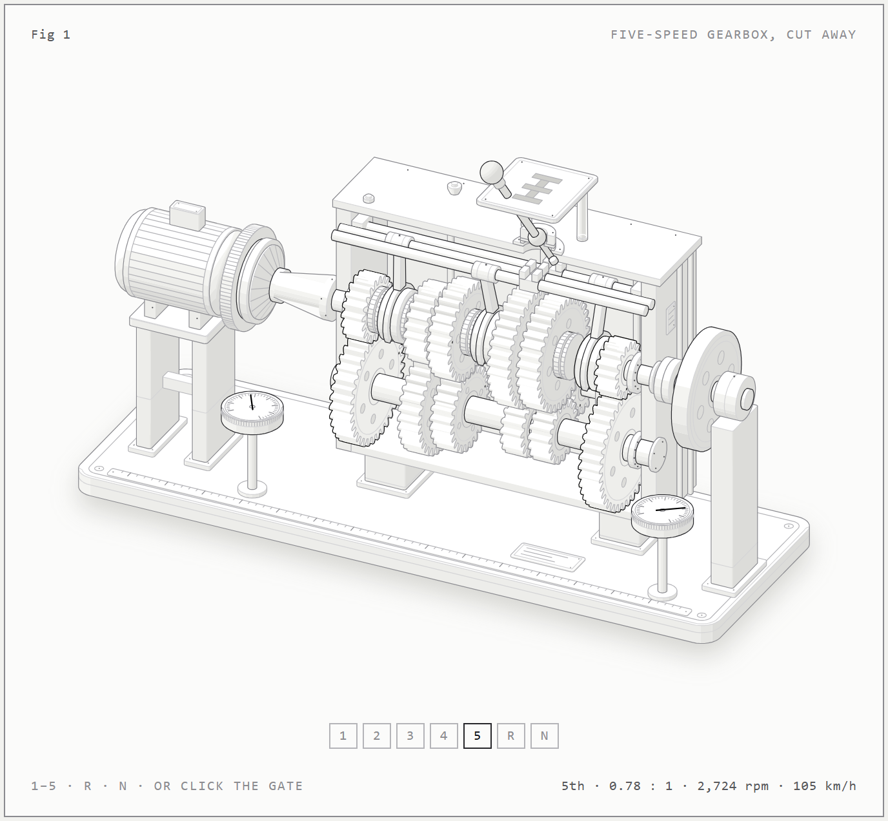

# Five-speed gearbox

An interactive, cut-away drawing of a five-speed manual gearbox on a test bench that shows how a gear shift works. An electric motor drives the input shaft through a clutch, and a heavy flywheel on the output stands in for the car. Pick a gear and watch the clutch open, the lever move a rail and fork, the synchro ring match the speeds, and the sleeve lock the new gear to the output shaft.



## Open it

Open `gear-shift/five-speed-gearbox.html` in a browser. It follows your system's light or dark setting and adds a step-by-step list and a ratio table under the figure. `gear-shift/gear-shift.html` (dark) and `gear-shift/gear-shift-light.html` are the figure on its own.

Controls: keys `1`–`5`, `R` and `N`, the arrow keys to shift up or down, the buttons under the figure, or a click on a position in the H-gate. When nobody touches it, it runs a tour: pull away in 1st, shift up to 5th, stop, reverse.

## How a shift works

1. **Clutch in.** The release bearing presses the diaphragm spring, which lifts the pressure plate off the friction disc. The engine no longer drives the input shaft.
2. **Out of gear.** The lever's finger pulls its rail back to the middle. The fork slides the sleeve off the old gear's dog teeth, and that gear spins free.
3. **Across the gate.** In neutral the finger moves sideways into another rail's slot.
4. **Synchronise.** The sleeve pushes a blocker ring onto the new gear's cone. Friction speeds up or slows down the input side until the new gear turns with the output shaft.
5. **Dogs engage.** With the speeds equal, the sleeve slides over the dog teeth and locks the gear to the output shaft.
6. **Clutch out.** The engine drives through the new pair. The car's speed did not change during the shift; the engine's did.

## The numbers

Every gear pair is always in mesh. The input's 19-tooth gear drives the layshaft's 35-tooth gear, and each forward gear multiplies that by its own pair.

| Gear | Layshaft → output teeth | Ratio | km/h at 3,000 rpm |
|---|---|---|---|
| 1st | 18 → 36 | 3.68 | 24 |
| 2nd | 25 → 29 | 2.14 | 42 |
| 3rd | 31 → 23 | 1.37 | 65 |
| 4th | locked 1 : 1 | 1.00 | 89 |
| 5th | 38 → 16 | 0.78 | 115 |
| R | 18 → 14 → 34 | 3.48 | 26 back |

Reverse adds a 14-tooth idler, so the output turns backwards. Road speeds assume a 3.91 final drive and a 1.94 m tyre. In the drawing the shafts turn at 1/150 of their real speed and each shift is slowed about three times.

## Rebuild

Needs Node 18 or later.

```bash
cd gear-shift
node build.mjs            # writes gear-shift.html and five-speed-gearbox.html
node build.mjs --light    # writes gear-shift-light.html
node build.mjs --audit    # checks the geometry: overlaps, supports, draw order
```

- `model.mjs`: tooth counts, ratios, and the engine, clutch, synchro and car model that the page runs
- `geometry.mjs`: where every part sits
- `gears.mjs`: involute gear teeth, redrawn each frame as the gears turn
- `build.mjs`: draws the static parts and writes the pages
- `live.js`: the animation, controls and readout

## Credits

Drawn with the Anatomy isometric kit in `anatomy/`, MIT licensed, copyright 2026 Ryan (see `anatomy/LICENSE`).
